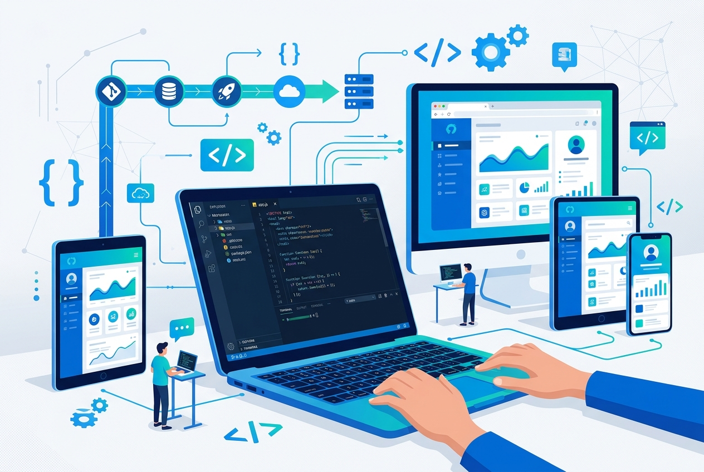
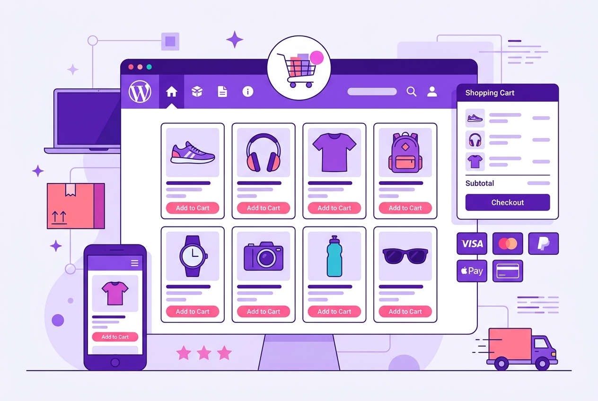
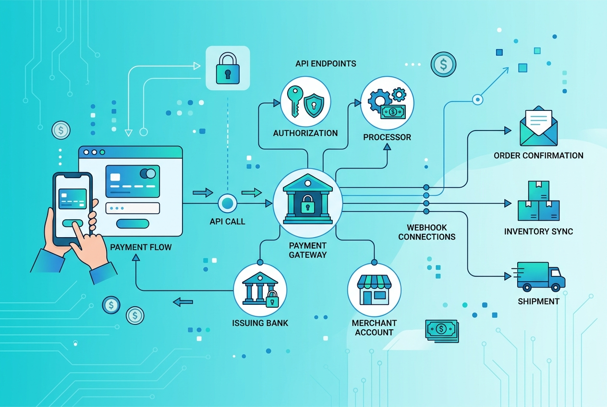
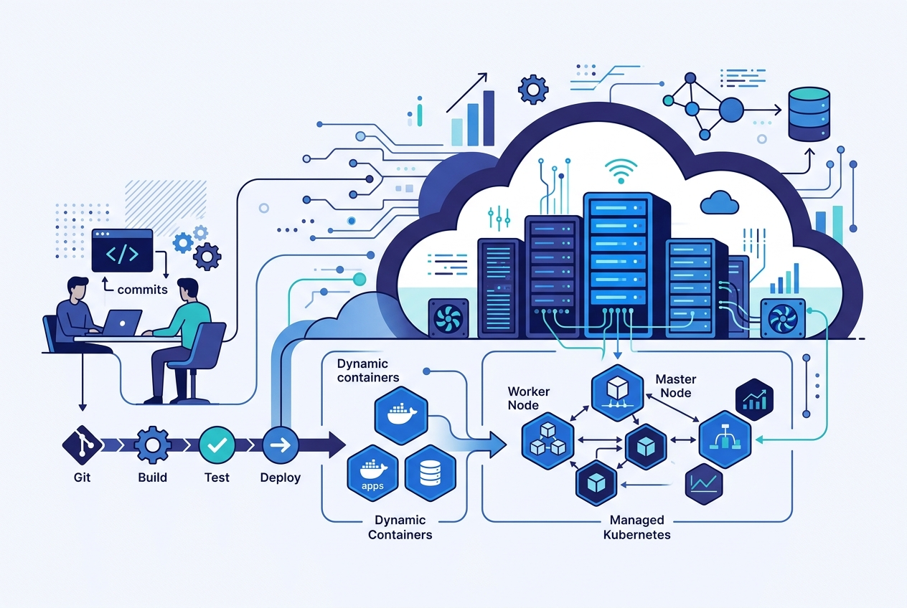
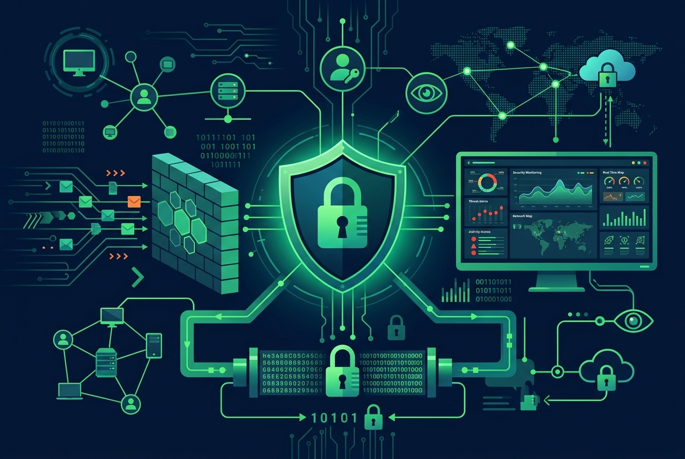
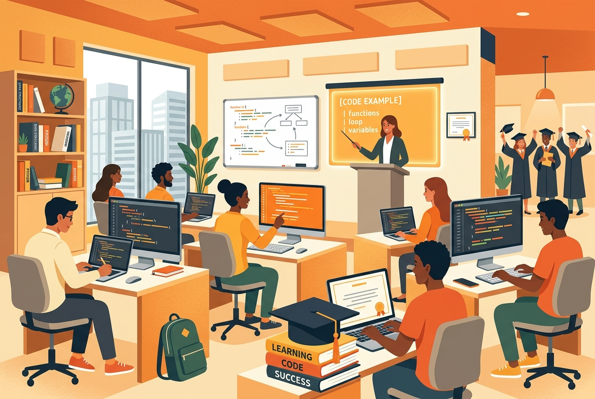
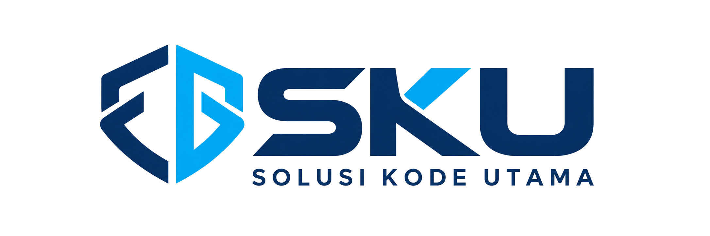
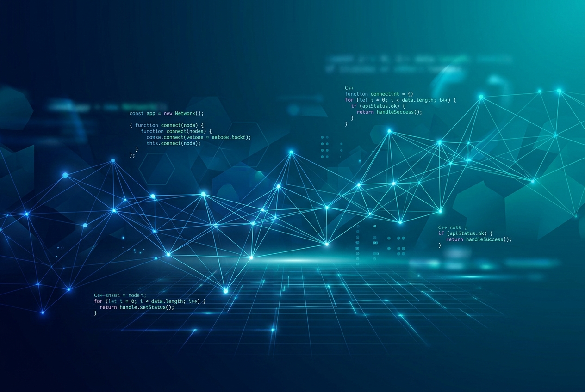

# Katalog Layanan PT Solusi Kode Utama

## 🎨 Service Thumbnails

### 1. Pengembangan Web & Aplikasi

- **File**: `web-development.jpg`
- **Ukuran**: 712 KB (1264 x 848 px)
- **Tema**: Blue/teal color scheme
- **Visual**: Code editor, responsive design, dashboard UI

---

### 2. WordPress & E-Commerce

- **File**: `wordpress-ecommerce.jpg`
- **Ukuran**: 540 KB (1264 x 848 px)
- **Tema**: Purple/pink color scheme
- **Visual**: Online store, shopping cart, payment methods

---

### 3. Integrasi API & Payment Gateway

- **File**: `api-integration.jpg`
- **Ukuran**: 592 KB (1264 x 848 px)
- **Tema**: Cyan/teal color scheme
- **Visual**: Connected nodes, API endpoints, payment flow

---

### 4. DevOps & Cloud Infrastructure

- **File**: `devops-cloud.jpg`
- **Ukuran**: 688 KB (1264 x 848 px)
- **Tema**: Indigo/blue color scheme
- **Visual**: Docker containers, servers, CI/CD pipeline

---

### 5. Konsultansi Keamanan Siber

- **File**: `cybersecurity.jpg`
- **Ukuran**: 668 KB (1264 x 848 px)
- **Tema**: Green/dark color scheme
- **Visual**: Shield with lock, firewall, security monitoring

---

### 6. Pelatihan & Pendidikan IT

- **File**: `it-training.jpg`
- **Ukuran**: 768 KB (1264 x 848 px)
- **Tema**: Orange/yellow color scheme
- **Visual**: Classroom, students, code screens, graduation cap

---

## 🖼️ Brand Assets

### Logo

- **File**: `sku-logo.png`
- **Ukuran**: 1.0 MB (2172 x 724 px)
- **Format**: PNG with transparency
- **Penggunaan**: Header (40px), Footer (36px)

### Hero Banner

- **File**: `bg-home-sku.jpg`
- **Ukuran**: 620 KB (1264 x 848 px)
- **Style**: Professional tech background, blue-teal gradient
- **Penggunaan**: Hero section background

### Favicons
- `favicon.ico` (32x32) — Standard browser favicon
- `favicon-64.png` (64x64) — High-res favicon

---

## 📊 Total Assets

| Kategori | Jumlah | Total Size |
|----------|--------|------------|
| Service Thumbnails | 6 | 3.9 MB |
| Logo | 1 | 1.0 MB |
| Hero Banner | 1 | 620 KB |
| Favicons | 2 | 8 KB |
| **TOTAL** | **10** | **~5.5 MB** |

---

## 🎯 Portfolio Section

Portofolio website menggunakan 8 gambar:
- 6 service thumbnails (di atas)
- 2 project showcase tambahan:
  - Sistem Informasi Enterprise (work-img-7.jpg)
  - Mobile App Development (work-img-8.jpg)

---

**Generated**: 24 Oktober 2026  
**Tool**: 9Router Image Generation (ag/gemini-3.1-flash-image)  
**Style**: Professional flat illustration, minimalist tech
